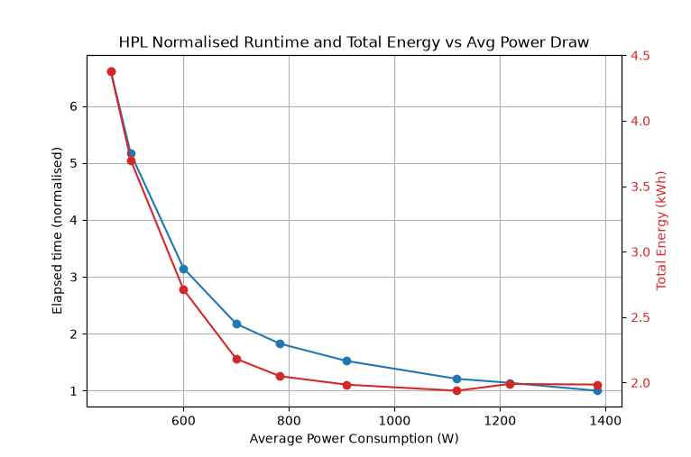
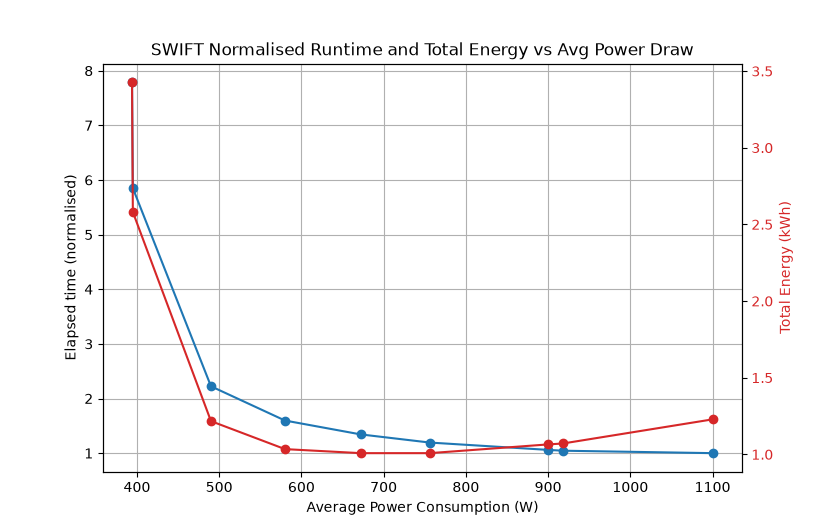

Durham Power-Cap case study
=====
.. _abstract:

Abstract
------------
Many modern server motherboards include integrated controllers which allow administrators to alter settings on demand.  One such setting allows an upper power limit to be imposed on the server.
We used this feature to investigate the performance impact of different power limits on different workloads, including one of the main simulation codes run on the COSMA supercomputer cluster.

Introduction
------------
Durham University hosts the COSMA Supercomputer, which is a memory-intensive cluster designed to perform large cosmology simulations.  As these workloads typically involve high memory usage and large amounts of storage I/O, CPU clock speed is often not the primary bottleneck, yet the CPU is the largest consumer of power.  By limiting the power drawn by the CPU to match the performance of the system's memory and storage, it may be possible to reduce the overall energy consumption per simulation, without severely impacting the job runtime.

Method
------------
A single node from Durham’s internal cluster (COSMA5) was reserved for exclusive use in the study.  The node was a Dell PowerEdge R6625, with an AMD EPYC 9754 CPU and 1.5TB of RAM, running Rocky Linux 9.8.  Jobs were scheduled using the SLURM scheduler.
Two key benchmarks were selected to test how different capabilities would be impacted by limiting the power draw of the node.  These benchmarks were:
* HPL - High Performance Linpack.  This benchmark solves a dense linear system in double arithmetic, and is the basis for the Top500 HPC leaderboard.  The AMD-optimised binary version was used.
* SWIFT - SPH with Inter-dependent Fine-grained Tasking.  A cosmology simulation which relies on floating point arithmetic, memory bandwidth, and data access.  Fixed initial conditions were used in order to assess the system under a reproducible "real-life" workload.  This was compiled for our test node using the Intel compiler and MPI implementation.

Dell servers equipped with an iDRAC (integrated Dell Remote Access Controller) have the capability to impose a limit on the motherboard’s overall power draw.  This study also explored whether this limit was strictly adhered to.

Beginning with the power cap disabled, each of the benchmarks were run individually, with their runtime and average power recorded.  The power cap was then enabled, and the limit reduced in increments of 200W.
After jobs had finished running, the average power consumption could be obtained from the iDrac interface.

Result
------------
.. _hpl:

  HPL: Normalised runtime and total energy usage against average power consumption

For limits above 1200W, total energy usage stays roughly the same, while runtime is noticably increased.
The data point at an average of ~1100 was the only measurement with a notable decrease in total energy usage, but at the expense of a 30% increase in runtime.

.. _swift:

  SWIFT: Normalised runtime and total energy usage against average power consumption

With no power cap, SWIFT does not draw the maximum power available to the node.  With a cap of 1000W, the average power draw was 918, with runtime minimally impacted, resulting in a significant reduction in total energy usage.  SWIFT consistently drew less power than was available, until the very lowest limits.

Lessons Learned
------------

Sustainability Impacts
------------
Limiting the peak power draw for compute nodes at full load can have a significant impact on the total energy usage of the system over time.  In locations where the power grid has a high carbon intensity, this can result in a significant reduction in carbon emissions, if the increased job runtime is acceptable.

Conclusions
------------
Workloads which are entirely CPU-bound, such as HPL, see performance degrade almost linearly at high powers, and see increased degradation at powers less than 50% of the uncapped value.  Given that CPU clock speed is scaled with power, this initial linear relationship makes sense when a CPU is being fully utilised.  
Energy savings with this benchmark were only achieved with significant increases in runtime: a 2.5% energy saving would result in a 21% increase in runtime.
Mixed workloads, such as SWIFT, which rely on CPU speed and memory bandwidth, see a much more gradual impact of power capping.  With the power cap set to 950W, an average consumption of 900W was observed, resulting in a 17.6% decrease in total energy usage, with only a 6% increase in runtime compared with the uncapped results.

